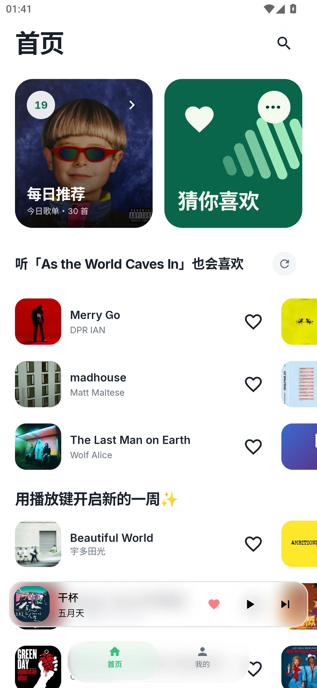
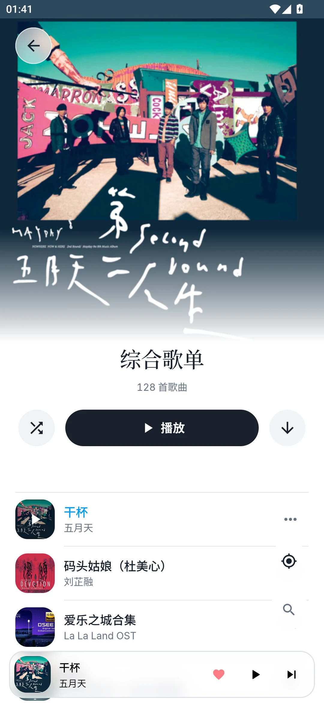
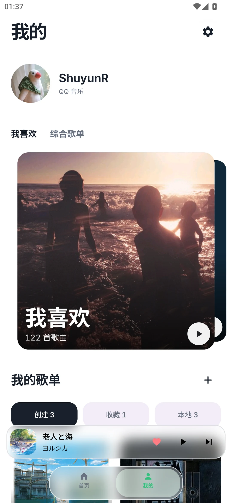
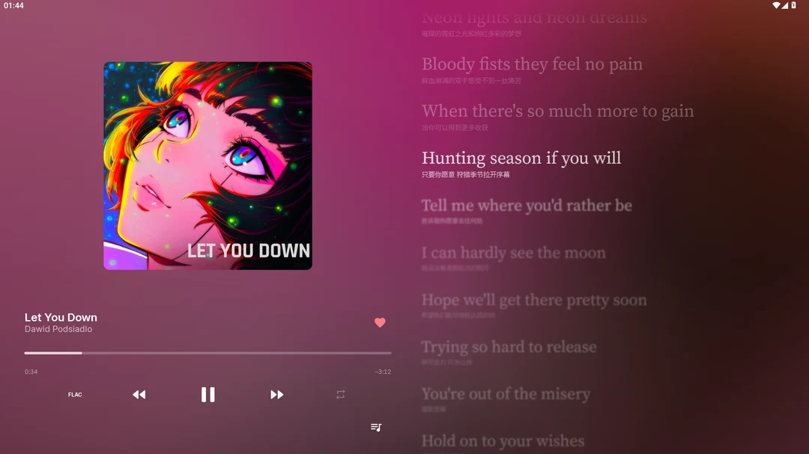
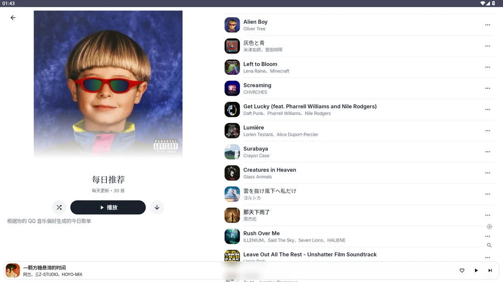
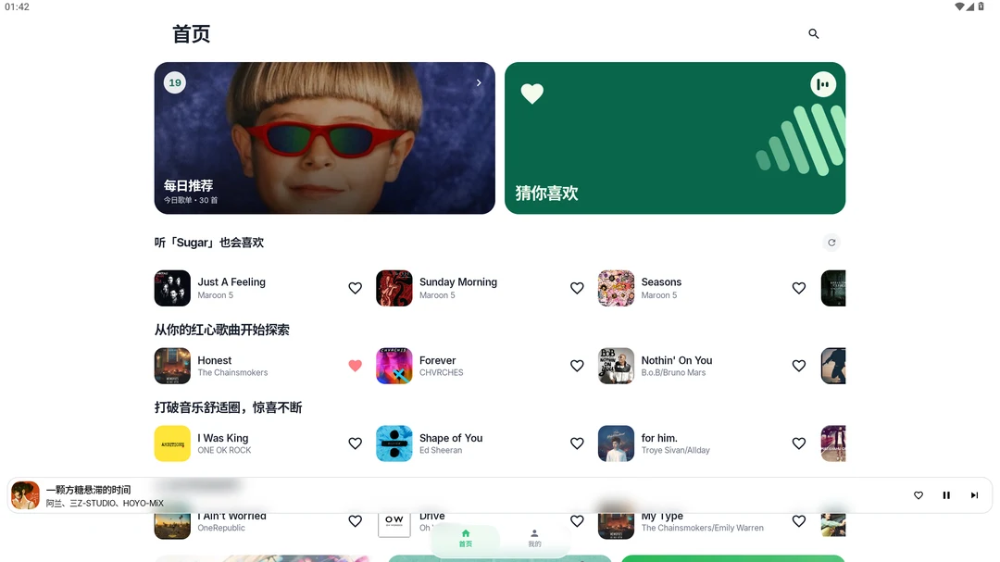
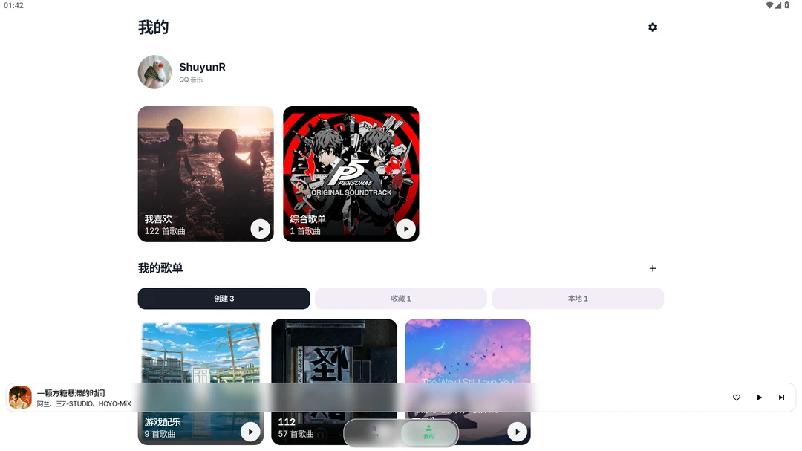

# MusicOne

*专注统一视觉、流畅体验与直觉动效的 Android 音乐播放器*

[📥 下载安装包](https://github.com/HGODLK/MusicOne/releases) • [📡 多音源整合](#-多音源整合) • [📑 歌单体系](#-歌单体系) • [🎼 音频格式](#-音频格式支持)

---

MusicOne 是一款基于 Jetpack Compose 构建的 Android 音乐播放器，支持 Android 6.0 及以上系统。

摒弃繁杂的社交模块与广告推广，专注于顺滑的交互手势、手机 / 平板自适应布局、本地无损解码与纯净音频输出。

> **提示**：应用内置 Profile 性能配置。首次启动或更新后，系统后台执行优化时可能短暂发热或掉帧，稍等片刻即可恢复。

  
手机

   
  <table width="100%">
    <tr>
      <td width="50%"></td>
      <td width="50%"></td>
    </tr>
    <tr>
      <td width="50%"></td>
      <td width="50%"></td>
    </tr>
  </table>

  
平板（点击展开）

   
  <table width="100%">
    <tr>
      <td width="50%"></td>
      <td width="50%"></td>
    </tr>
    <tr>
      <td width="50%"></td>
      <td width="50%"></td>
    </tr>
  </table>

## 📡 多音源整合

MusicOne 践行“音源即能力”的设计理念，以播放能力为核心，划分为**主音源**与**补充音源**：

- **主音源**：选择某一平台作为主音源，承载核心的首页推荐、精选歌单、搜索发现与个人收藏体系。
- **补充音源**：其他平台与音源均可作为补充音源协同使用，负责收藏夹订阅、曲目匹配与播放补全。
- **音源识别**：歌曲主题色随所属音源变化，在混合播放时可直观判断曲目来源。
- **账号与权限**：在线曲目的播放与音质档位遵循对应平台的账号权限，受版权保护或 VIP 曲目需登录持有相应权益的账号。
- **隐私与安全**：账号凭证仅保存在设备本地私有存储，音源请求由客户端直接发起，不设中转服务器。
- **统一媒体模型**：抹平不同音源的协议、接口与音频格式差异，统一手势、动效与播放队列调度。

### 主音源

| 平台 | 状态 | 说明 |
| :--- | :---: | :--- |
| **QQ 音乐** | 🟢 可用 | 支持首页推荐、搜索、歌单与个人收藏 |
| **本地音乐** | 🟢 可用 | 支持音频文件导入与本地歌单管理 |
| **网易云音乐** | 🔴 暂不适配 | 暂不适配，当前可作为补充音源使用 |
| **酷狗音乐** | 🔴 暂不适配 | 暂不适配，当前可作为补充音源使用 |

### 补充音源

| 平台 | 状态 | 说明 |
| :--- | :---: | :--- |
| **哔哩哔哩** | 🟢 可用 | 支持输入 BV 号或链接解析播放，亦可直接获取并订阅账号收藏夹 |

## 📑 歌单体系

在“我的”页面中，歌单按入口与管理维度分为两级结构：

- **一级歌单**（常驻核心入口）：
  - **我喜欢**：个人红心收藏主入口，登录后与主音源云端双向同步。
  - **综合歌单**：跨音源常驻歌单，支持将不同音源曲目统一加入其中进行混合管理与播放。
- **二级歌单**（分类歌单列表）：
  - **自建与平台收藏**：承载日常自建歌单与平台收藏歌单，支持多选、排序、编辑及跨源曲目自由组合。
  - **订阅歌单**：隶属于二级歌单的特殊类别，专为哔哩哔哩音频收藏夹等外部音源设计，保持与远端更新同步，可直接播放或一键转存至自建歌单。

## 🎼 音频格式支持

支持 MP3、FLAC、WAV、AAC、M4A、OGG、OGA、OPUS、APE、WV、DSF、DFF、ALAC、AIFF、AIF、MP4 等音频格式，支持外接 USB DAC 独占输出（Bit-Perfect）。

*注：WV 暂不支持 Hybrid 双文件（`.wv` + `.wvc`）；DFF 暂不支持 DST 压缩；DSD 暂不支持 ISO 镜像及 DoP 直出。*

## 👥 开发者与鸣谢

### 开发者

- **ShuyunR** ([@HGODLK](https://github.com/HGODLK)) - 架构设计、交互体系与音频工程
- **Killy** ([@Killy806](https://github.com/Killy806)) - 网易云音乐模块开发

### 测试鸣谢

- **Loka**
- **AcFeng-J** ([@AcFeng-J](https://github.com/AcFeng-J))
- **ZJiaYi106** ([@ZJiaYi106](https://github.com/ZJiaYi106))

---

感谢开源社区中 FFmpeg、ExoPlayer / Media3 及相关音频开源项目的杰出贡献。

## 📄 开源协议

本项目基于 [MIT License](LICENSE) 许可协议开源。

## ⚠️ 免责声明

请遵守各平台服务条款，使用风险自负。所有在线音源、媒体数据及相关知识产权均归属原始平台与版权方所有，本项目不提供任何音频抓取、越权破解或商业化营利服务。
